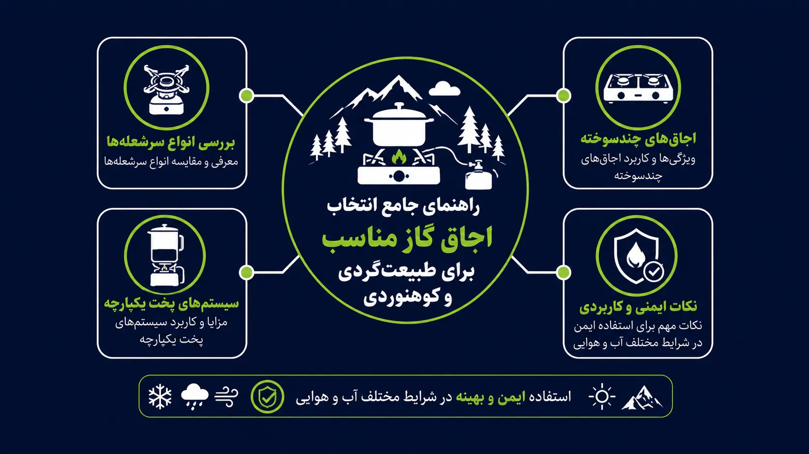

<!-- بلوک سئو — فقط برای ویراستار؛ در صفحه نمایش داده نشود
عنوان سئو: معرفی اجاق‌های کوهنوردی؛ راهنمای خرید اجاق گاز سفری
توضیح متا: نمی‌دونی برای طبیعت‌گردی چه اجاقی بخری؟ تو این مقاله انواع اجاق کوهنوردی، از سرشعله‌های سبک تا اجاق‌های بنزینی رو بررسی کردیم تا تو سرما و باد، غذای گرم بخوری.
کلمهٔ کلیدی اصلی: اجاق کوهنوردی
کلمات کلیدی فرعی: اجاق گاز سفری, خرید اجاق کمپینگ, اجاق بادگیر, سرشعله کوهنوردی, اجاق چندسوخته
نامک: camping-stove-review
سطح ریسک: متوسط؛ کار با شعله و سوخت پرفشار
اسکیما: Article، BreadcrumbList، FAQPage
چکیده: راهنمای جامع انتخاب اجاق گاز مناسب برای طبیعت‌گردی و کوهنوردی. بررسی انواع سرشعله‌ها، اجاق‌های چندسوخته، سیستم‌های پخت یکپارچه و نکات ایمنی و کاربردی در شرایط مختلف آب و هوایی.
تصویر شاخص: guides/camping-stove-review.webp
متن جایگزین تصویر: اینفوگرافیک اجاق کوهنوردی: اجاق کپسولی، اجاق سوخت مایع و اجاق الکلی
وضعیت: آمادهٔ انتشار
-->

# معرفی اجاق‌های کوهنوردی؛ چطور تو دل کوه و جنگل غذای گرم بخوریم؟

**نویسنده:** تیم تحریریه آموزش‌های بقا | **آخرین به‌روزرسانی:** ۲۲ مهر ۱۴۰۵ | [روش تهیهٔ مقالات](/editorial-policy)

> **پاسخ سریع:** برای سه فصل و سفر کوتاه، سرشعلهٔ کوچک روی کپسول پیچی کافی است؛ برای جوشاندن سریع و باد، سیستم یکپارچه؛ برای زمستان و ارتفاع، اجاق چندسوخته. مهم‌تر از مدل، تمرین روشن‌کردن در خانه، بادگیر، سوخت کافی و این قانون است: هرگز داخل چادر.

> ### ⚠️ گاز، شعله و فضای بسته
> هیچ اجاقی را داخل چادر، زیر سایه‌بان بسته یا در خودرو روشن نکن؛ مونوکسید کربن بی‌بو و کشنده است و پارچهٔ چادر در چند ثانیه آتش می‌گیرد. کپسول را هرگز روی شعله یا در خودروی داغ گرم نکن. اجاق چندسوخته هنگام پیش‌گرم‌کردن شعلهٔ بلند می‌دهد؛ فقط در فضای باز و با فاصله از وسایل روشنش کن.

## مقدمه

فرض کن ساعت هشت شب در ارتفاعات، باد سرد می‌وزد و تنها چیزی که بین تو و یک شام گرم فاصله انداخته، اجاقی است که یا روشن نمی‌شود یا شعله‌اش در باد به جایی نمی‌رسد. انتخاب اجاق درست یعنی این لحظه پیش نیاید. پایین‌تر انواع اجاق‌های طبیعت‌گردی را با هم مقایسه می‌کنیم، می‌بینی کدام برای چه فصلی و چه سفری مناسب است، و اگر اجاقت خراب شد چه جایگزینی داری.

## پیش‌نیازها و شرایط

- فصل و دمای شب مقصد را بدان؛ کپسول گاز معمولی در سرمای زیر صفر ضعیف می‌شود.
- تعداد نفرات و تعداد وعده‌های گرم را مشخص کن تا مصرف سوخت را تخمین بزنی.
- نوع کپسول در دسترس در مسیر (پیچی یا سوزنی) را با اجاقت تطبیق بده.
- بادگیر یا امکان پناه از باد برای اجاق فراهم کن؛ باد مصرف سوخت را چند برابر می‌کند.
- اجاق را قبل از سفر یک بار در حیاط روشن کن و واشرها و شیر را چک کن.

## جدول مقایسه: کدام اجاق برای کدام سفر

| نوع | وزن و مصرف سوخت | باد و سرما | مناسب برای | ضعف اصلی |
|---|---|---|---|---|
| سرشعلهٔ کوچک روی کپسول | خیلی سبک؛ مصرف متوسط | ضعیف در باد، افت در سرما | سه‌فصل، پیمایش سبک | ناپایداری با قابلمهٔ بزرگ |
| سیستم یکپارچه | متوسط؛ مصرف کم (جوشاندن سریع) | خوب در باد | جوشاندن آب، گروه کوچک | گران، فقط جوشاندن |
| چندسوخته (بنزینی) | سنگین؛ مصرف کم | عالی در سرما و ارتفاع | زمستان، ارتفاع، سفر طولانی | نگهداری، پیش‌گرم، دود |
| اجاق پیک‌نیکی رومیزی | سنگین؛ مصرف زیاد | ضعیف | کمپ کنار خودرو | حمل در کوله ممکن نیست |

## روش گام‌به‌گام: انواع اجاق‌های طبیعت‌گردی

**مناسب برای:** انتخاب و استفادهٔ اجاق برای کمپ و پیمایش سه‌فصل؛ برنامه‌های زمستانی و ارتفاع بالا به تجربه و تجهیزات تخصصی نیاز دارد.

**لازم داری:** اجاق، سوخت کافی به‌علاوهٔ ذخیره، فندک و کبریت یدک، بادگیر، سطح صاف و پایدار، قابلمهٔ درپوش‌دار.

**زمان:** جوشاندن یک لیتر آب با سرشعلهٔ معمولی در شرایط آرام حدود ۴ تا ۶ دقیقه؛ در باد و سرما بیشتر.

**هشدار:** اجاق را روی سطح پایدار بگذار و در حین کار رهایش نکن؛ واژگونی قابلمهٔ آب جوش شایع‌ترین حادثهٔ کمپ است.

**تصویر:** اینفوگرافیک انگلیسی همین مقاله در ادامه آمده است.


هر اجاقی برای یه شرایط خاصی ساخته شده. نمی‌تونی با یه ابزار همه کارها رو انجام بدی. بذار انواعش رو برات کالبدشکافی کنم.

۱. **سرشعله‌های پیچی و سوزنی (سبک و سریع)**

این‌ها مستقیم روی کپسول گاز پیچ می‌شن. مدل‌های سوزنی شلنگ دارن و تعادل بهتری برای قابلمه‌های بزرگتر دارن.

- مزایا: فوق‌العاده سبک، جمع‌وجور، راه‌اندازی در چند ثانیه.

- معایب: تو بادهای شدید بدون بادگیر کارایی‌شون رو از دست می‌دن. تو سرمای زیر صفر، فشار کپسول افت می‌کنه و شعله ضعیف میشه.

۲. **اجاق‌های سیستم پخت یکپارچه (بادگیر و سریع)**

این‌ها یه کیت کامل هستن. سرشعله، قابلمه و بادگیر به هم وصلن و حرارت مستقیم میره تو کف قابلمه.

- مزایا: مصرف گاز به شدت پایین، جوش آوردن آب در زمان رکورد، مقاومت عالی در برابر باد.

- معایب: سنگین‌تر، جاگیرتر، و فقط برای جوش آوردن آب یا پخت‌های ساده مناسبه. نمی‌تونی باهاش مثل یه قابلمه معمولی آشپزی کنی و غذا رو هم بزنی.

۳. **اجاق‌های چندسوخته یا بنزینی (غول‌های زمستون)**

این اجاق‌ها با بنزین سفید، بنزین معمولی یا حتی نفت کار می‌کنن.

- مزایا: تو سرمای شدید و ارتفاعات بالا که گاز مایع کار نمی‌کنه، این‌ها مثل موتور دیزل روشن می‌شن. قدرت حرارتی فوق‌العاده بالا.

- معایب: سنگین، نیاز به پمپاژ و گرم کردن اولیه (Priming)، بوی سوخت می‌دن و نگهداری‌شون سخت‌تره.

جایگزین خلاقانه: اگه سفرت کوتاهه و نمی‌خوای هزینه اجاق بدی، یا اگه وسط سفر اجاقت خراب شد، می‌تونی با یه قوطی کنسرو خالی و الکل صنعتی (یا چوب‌های رزینی)، یه اجاق اضطراری بسازی. (توی مقاله ساخت اجاق با قوطی کنسرو کامل یادت دادم). این روش شاید برای پخت غذای پیچیده عالی نباشه، ولی برای جوش آوردن آب و درست کردن چای تو شرایط بقا کاملاً نجاتت می‌ده.

## بومی‌سازی برای ایران

- کپسول‌های پیچی (رزوه‌ای) و سوزنی هر دو در بازار ایران پیدا می‌شوند، ولی در شهرهای کوچک ممکن است فقط یکی موجود باشد؛ قبل از سفر از فروشگاه مقصد بپرس یا رابط (آداپتور) همراه ببر.
- در دماوند، سبلان و علم‌کوه، سرما و ارتفاع هم‌زمان کپسول گاز را ضعیف می‌کنند؛ کپسول «چهارفصل» (مخلوط ایزوبوتان/پروپان) یا اجاق چندسوخته انتخاب مطمئن‌تری است.
- در فصل خشک و در مناطق حفاظت‌شده، آتش روباز معمولاً ممنوع می‌شود ولی اجاق گاز با رعایت احتیاط مجاز است؛ از محیط‌بان بپرس.
- کپسول گاز را نمی‌توان با هواپیما برد؛ خرید در مقصد را برنامه‌ریزی کن و کپسول خالی را به شهر برگردان.
- بنزین معمولی ایران برای اجاق‌های چندسوخته قابل استفاده است اما ژیگلور را زودتر کثیف می‌کند؛ تمیزکردن مرتب لازم است.

## نکات ایمنی

۱. هشدار جدی: هرگز، تکرار می‌کنم هرگز، اجاق گاز رو داخل چادر روشن نکن. حتی اگه در چادر باز باشه. احتراق ناقص گاز، گاز مونوکسید کربن تولید می‌کنه. این گاز بی‌بو و بی‌رنگه و تو خواب خفه‌ات می‌کنه. آشپزخونه تو همیشه باید زیر آسمون باز یا تو فضای جلویی چادر با تهویه کامل باشه.

۲. قبل از تعویض کپسول، شعله کاملاً خاموش و اجاق سرد باشد؛ نشت را با بو و صدا بشناس و هرگز با فندک دنبال نشت نگرد.

۳. کپسول و بطری سوخت را دور از اجاق و آفتاب مستقیم نگه دار.

۴. اجاق بنزینی را دور از چادر و وسایل، روی سنگ یا خاک، پیش‌گرم کن و در صورت شعله‌ورشدن ناگهانی عقب برو و شیر را ببند.

۵. در سوختگی، محل را ۱۰ تا ۲۰ دقیقه زیر آب خنک بگیر، چیزی روی آن نمال و اگر سوختگی بزرگ یا روی صورت و دست‌هاست با ۱۱۵ تماس بگیر.

## باورهای غلط

**باور غلط:** «هر اجاقی که شعله‌اش آبی‌تره و قوی‌تره، بهتره.»

**واقعیت:** قدرت زیاد یعنی مصرف سوخت بیشتر. تو طبیعت هر گرم سوخت طلاست. اجاقی بخر که با کمترین سوخت، بیشترین حرارت رو به ظرف منتقل کنه، نه اینکه فقط آتیش بازی راه بندازه.

**باور غلط:** «کپسول گاز بزرگتر بخرم که خیالم راحت باشه.»

**واقعیت:** کپسول بزرگ یعنی وزن اضافه تو کوله. برای یه سفر سه روزه، همون کپسول‌های استاندارد ۲۳۰ گرمی کاملاً کافیه. پولت رو برای حمل بار اضافه هدر نده.

**باور غلط:** «اجاق کوچک سبک برای زمستان هم جواب می‌دهد، فقط باید بیشتر صبر کرد.»

**واقعیت:** در سرمای زیر صفر، فشار کپسول گاز معمولی به‌شدت افت می‌کند و ممکن است اصلاً روشن نشود؛ برای زمستان کپسول چهارفصل یا اجاق چندسوخته لازم است.

## عیب‌یابی و علائم خطر

- **اجاق روشن نمی‌شود:** شیر و اتصال کپسول را چک کن، جرقه‌زن خراب است؟ با فندک/کبریت امتحان کن؛ کپسول در سرماست؟ در جیب گرمش کن.
- **شعله زرد و دودی:** ژیگلور یا ورودی هوا کثیف است یا کپسول رو به اتمام؛ خاموش کن، سرد شود، تمیز کن.
- **شعله در باد به جایی نمی‌رسد:** بادگیر بگذار (نه دور تا دور کپسول که داغ شود)، جای کم‌باد پیدا کن، درپوش قابلمه را ببند.
- **علائم خطر:** بوی گاز مداوم، کپسول داغ یا متورم، شعلهٔ بلند خارج از کنترل = شیر را ببند، عقب برو، در صورت آتش گسترده با ۱۲۵ (آتش‌نشانی) و در صورت مصدومیت با ۱۱۵ تماس بگیر.

## پیشگیری و کیت

- واشر یدک (اورینگ) و فندک دوم جزء ثابت کیت اجاق باشد.
- کپسول نیمه را بعد از سفر وزن کن یا علامت بزن تا دفعهٔ بعد غافلگیر نشوی.
- اجاق را بعد از سفر تمیز و خشک کن و در کیسهٔ خودش نگه دار.
- یک بار در سال اجاق را کامل امتحان کن و دفترچهٔ سازنده را دربارهٔ نگهداری دنبال کن.

## پرسش‌های رایج

**۱. تو هوای خیلی سرد، کپسول گاز ضعیف میشه. چیکار کنم؟**

کپسول‌های گاز تو سرما فشارشون افت می‌کنه. راه‌حل کماندوها اینه: شب کپسول رو بذار داخل کیسه‌خوابت تا گرمای بدنت اون رو گرم نگه داره. موقع استفاده هم کپسول رو تو مشتات گرم کن یا بذار تو یه کاسه آب ولرم (هرگز آب جوش نه، خطرناکه!). اگه زیاد تو زمستون میری، کلاً به اجاق‌های بنزینی فکر کن.

**۲. چطور بفهمم چقدر گاز برای سفرم نیاز دارم؟**

قانون سرانگشتی اینه: برای هر نفر در روز، حدود ۵۰ گرم گاز نیاز داری (فقط برای جوش آوردن آب و پخت‌های ساده). پس یه کپسول ۲۳۰ گرمی، برای یه نفر تو سفر ۳ تا ۴ روزه کاملاً کافیه. همیشه یه کپسول پر اضافه به عنوان پشتیبان تو کوله‌ت داشته باش.

**۳. شعله اجاق زرد می‌سوزه و دوده می‌زنه. مشکل چیه؟**

این یعنی احتراق ناقصه. یا بادگیر نداری و باد می‌وزه، یا نازل (سوراخ ریز گاز) گرفته. اول با سوزن یا همون ابزار تمیزکننده‌ای که روی خود اجاق هست، نازل رو تمیز کن. دوم، حتماً از بادگیر استفاده کن تا شعله آبی و متمرکز بسوزه و گازت هدر نره.

**۴. آیا می‌تونم از اجاق‌های پیک‌نیکی خونه برای کوهنوردی استفاده کنم؟**

می‌تونی، ولی اصلاً توصیه نمی‌کنم. اجاق‌های پیک‌نیکی سنگینن، جای زیادی می‌گیرن و تو بادهای کوهستان به شدت ناپایدارن. اگه با ماشین میری و وزن مهم نیست، مشکلی نیست. ولی اگه قراره کوله‌پشتی رو بندازی پشتت، فقط به اجاق‌های تخصصی کوهنوردی فکر کن تا کمرت نابود نشه.

**۵. اگه وسط سفر اورینگ (O-ring) اجاقم خراب شد چیکار کنم؟**

همیشه یه اورینگ زاپاس تو کیفت داشته باش. این قطعه لاستیکی کوچیک رو می‌تونی از تعمیرگاه‌های دوچرخه یا حتی با بریدن یه تیکه لاستیک سیلیکونی ضخیم تهیه کنی. اگه شلنگ سوراخ شد، با چسب نواری پهن موقتاً درز رو بگیر تا به شهر برسی، ولی بهش اعتماد نکن و سریع تعویضش کن.

## چک‌لیست جمع‌بندی

وقتی می‌خوای اجاق بخری یا تو سفر استفاده کنی، این مسیر رو تو ذهنت طی کن:

نوع سفرت چیه؟

- [ ] کمپینگ ماشین‌سو: اجاق پیک‌نیکی یا سرشعله سوزنی سنگین.

- [ ] کوهنوردی سبک و سه فصل: سرشعله پیچی سبک + بادگیر.

- [ ] زمستون و ارتفاعات بالا: اجاق چندسوخته بنزینی.

- [ ] جوش آوردن سریع آب: سیستم پخت یکپارچه.

نکات ایمنی و نگهداری:

- [ ] هرگز داخل چادر روشن نکن.

- [ ] اورینگ زاپاس و فندک همیشه همراهت باشه.

- [ ] کپسول رو شب تو کیسه‌خواب نگه دار تا یخ نزنه.

- [ ] بعد از سفر، نازل رو تمیز کن.

## لینک‌های مرتبط

- [تجهیزات پخت‌وپز در طبیعت](/outdoor-cooking-equipment)
- [ساخت اجاق با قوطی کنسرو](/diy-can-stove) — جایگزین اضطراری
- [خاموش کردن کامل و ایمن آتش](/how-to-extinguish-campfire)
- [چک‌لیست کامل وسایل ضروری کمپینگ](/camping-essential-checklist)
- [هاب آموزش‌های کمپینگ](/category/camping-survival/)

## منابع

- سرویس پارک‌های ملی آمریکا (NPS) — راهنمای ایمنی اجاق و آتش در کمپ.
- مراکز کنترل بیماری آمریکا (CDC) — مسمومیت با مونوکسید کربن از وسایل سوخت‌سوز در فضای بسته.
- دفترچه‌های راهنمای سازندگان اجاق‌های کوهنوردی — نگهداری، تعویض واشر و پیش‌گرم اجاق‌های چندسوخته.
- پیوند منابع پس از تأیید URL اضافه می‌شود؛ تا آن زمان نام سازمان و موضوع راهنما درج شده است.

## پیام پایانی

رفیق، اجاق گاز تو طبیعت فقط یه وسیله نیست، قلب تپنده کمپ توئه.

موقع استفاده، حواست به زیر قابلمه باشه که باد شعله رو منحرف نکنه. بعد از هر سفر، سرشعله رو با یه مسواک کهنه تمیز کن تا چربی و دوده نگیره و عمرش بیشتر بشه.

مراقب خودت باش، تو سرما و باد غذای گرم بخور و از صدای جلز و ولز غذا تو دل طبیعت لذت ببر.

---


*این مقاله جنبهٔ آموزشی دارد و جایگزین توصیهٔ پزشکی، راهنمای محلی، آموزش عملی یا دستور سازندهٔ محصولات نیست.*

## اسکیما برای پیاده‌سازی

```json
{
  "@context": "https://schema.org",
  "@graph": [
    {
      "@type": "Article",
      "headline": "معرفی اجاق‌های کوهنوردی؛ چطور تو دل کوه و جنگل غذای گرم بخوریم؟",
      "description": "نمی‌دونی برای طبیعت‌گردی چه اجاقی بخری؟ تو این مقاله انواع اجاق کوهنوردی، از سرشعله‌های سبک تا اجاق‌های بنزینی رو بررسی کردیم تا تو سرما و باد، غذای گرم بخوری.",
      "inLanguage": "fa",
      "url": "https://sarzaminaryan.ir/camping-stove-review/",
      "mainEntityOfPage": "https://sarzaminaryan.ir/camping-stove-review/",
      "author": {
        "@type": "Organization",
        "name": "تیم تحریریه آموزش‌های بقا"
      },
      "publisher": {
        "@type": "Organization",
        "name": "تیم تحریریه آموزش‌های بقا"
      },
      "dateModified": "2026-10-11"
    },
    {
      "@type": "BreadcrumbList",
      "itemListElement": [
        {
          "@type": "ListItem",
          "position": 1,
          "name": "خانه",
          "item": "https://sarzaminaryan.ir/"
        },
        {
          "@type": "ListItem",
          "position": 2,
          "name": "اجاق کوهنوردی",
          "item": "https://sarzaminaryan.ir/camping-stove-review/"
        }
      ]
    },
    {
      "@type": "FAQPage",
      "mainEntity": [
        {
          "@type": "Question",
          "name": "تو هوای خیلی سرد، کپسول گاز ضعیف میشه. چیکار کنم؟",
          "acceptedAnswer": {
            "@type": "Answer",
            "text": "کپسول‌های گاز تو سرما فشارشون افت می‌کنه. راه‌حل کماندوها اینه: شب کپسول رو بذار داخل کیسه‌خوابت تا گرمای بدنت اون رو گرم نگه داره. موقع استفاده هم کپسول رو تو مشتات گرم کن یا بذار تو یه کاسه آب ولرم (هرگز آب جوش نه، خطرناکه!). اگه زیاد تو زمستون میری، کلاً به اجاق‌های بنزینی فکر کن."
          }
        },
        {
          "@type": "Question",
          "name": "چطور بفهمم چقدر گاز برای سفرم نیاز دارم؟",
          "acceptedAnswer": {
            "@type": "Answer",
            "text": "قانون سرانگشتی اینه: برای هر نفر در روز، حدود ۵۰ گرم گاز نیاز داری (فقط برای جوش آوردن آب و پخت‌های ساده). پس یه کپسول ۲۳۰ گرمی، برای یه نفر تو سفر ۳ تا ۴ روزه کاملاً کافیه. همیشه یه کپسول پر اضافه به عنوان پشتیبان تو کوله‌ت داشته باش."
          }
        },
        {
          "@type": "Question",
          "name": "شعله اجاق زرد می‌سوزه و دوده می‌زنه. مشکل چیه؟",
          "acceptedAnswer": {
            "@type": "Answer",
            "text": "این یعنی احتراق ناقصه. یا بادگیر نداری و باد می‌وزه، یا نازل (سوراخ ریز گاز) گرفته. اول با سوزن یا همون ابزار تمیزکننده‌ای که روی خود اجاق هست، نازل رو تمیز کن. دوم، حتماً از بادگیر استفاده کن تا شعله آبی و متمرکز بسوزه و گازت هدر نره."
          }
        },
        {
          "@type": "Question",
          "name": "آیا می‌تونم از اجاق‌های پیک‌نیکی خونه برای کوهنوردی استفاده کنم؟",
          "acceptedAnswer": {
            "@type": "Answer",
            "text": "می‌تونی، ولی اصلاً توصیه نمی‌کنم. اجاق‌های پیک‌نیکی سنگینن، جای زیادی می‌گیرن و تو بادهای کوهستان به شدت ناپایدارن. اگه با ماشین میری و وزن مهم نیست، مشکلی نیست. ولی اگه قراره کوله‌پشتی رو بندازی پشتت، فقط به اجاق‌های تخصصی کوهنوردی فکر کن تا کمرت نابود نشه."
          }
        },
        {
          "@type": "Question",
          "name": "اگه وسط سفر اورینگ (O-ring) اجاقم خراب شد چیکار کنم؟",
          "acceptedAnswer": {
            "@type": "Answer",
            "text": "همیشه یه اورینگ زاپاس تو کیفت داشته باش. این قطعه لاستیکی کوچیک رو می‌تونی از تعمیرگاه‌های دوچرخه یا حتی با بریدن یه تیکه لاستیک سیلیکونی ضخیم تهیه کنی. اگه شلنگ سوراخ شد، با چسب نواری پهن موقتاً درز رو بگیر تا به شهر برسی، ولی بهش اعتماد نکن و سریع تعویضش کن."
          }
        }
      ]
    }
  ]
}
```
