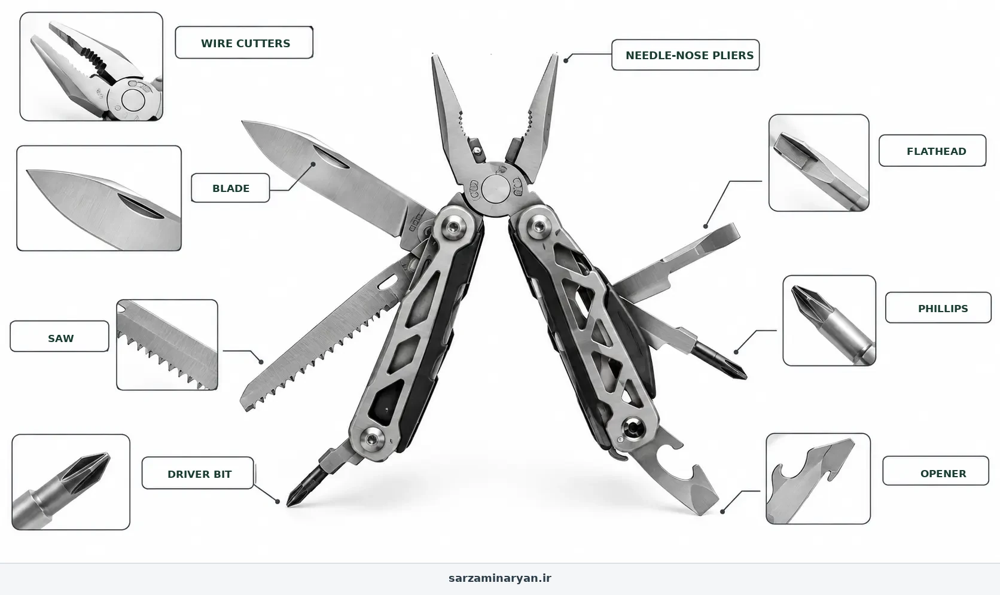

<!-- بلوک سئو — فقط برای ویراستار؛ در صفحه نمایش داده نشود
عنوان سئو: معرفی چاقوهای چندکاره | ابزار همه‌کارهٔ طبیعت‌گردی
توضیح متا: دنبال بهترین چاقوی چندکاره برای طبیعت‌گردی هستی؟ تو این مقاله انواع مولتی‌تول، چاقوی سوئیسی و ابزارهای بقا رو بررسی کردیم تا تو شرایط اضطراری کم نیاری.
کلمهٔ کلیدی اصلی: چاقوهای چندکاره
کلمات کلیدی فرعی: چاقوی بقا، مولتی تول، چاقوی سوئیسی، ابزار چندکاره کمپینگ، خرید چاقو طبیعت
نامک: multi-tool-knife-review
سطح ریسک: کم تا متوسط؛ ابزار تیز
اسکیما: Article، BreadcrumbList، FAQPage
چکیده: راهنمای جامع انتخاب بهترین چاقوی چندکاره (مولتی‌تول) برای طبیعت‌گردی و بقا. بررسی تفاوت چاقوی سوئیسی، مدل‌های انبردستی و ابزارهای بقا، جنس تیغه، و نکات ایمنی و نگهداری.
تصویر شاخص: guides/multi-tool-knife-review.webp
متن جایگزین تصویر: اینفوگرافیک چاقوهای چندکاره: انبردست، تیغه، اره، پیچ‌گوشتی و دربازکن
وضعیت: آمادهٔ انتشار
-->

# معرفی چاقوهای چندکاره؛ آچار فرانسه طبیعت‌گردی رو چطور انتخاب کنیم؟

**نویسنده:** تیم تحریریه آموزش‌های بقا | **آخرین به‌روزرسانی:** ۲۲ مهر ۱۴۰۵ | [روش تهیهٔ مقالات](/editorial-policy)

> **پاسخ سریع:** برای کمپ معمولی یک چاقوی تاشوی سبک با قفل تیغه و چند ابزار پرکاربرد (دربازکن، پیچ‌گوشتی، قیچی کوچک) کافی است؛ انبردست چندکاره برای تعمیرات و چاقوی تیغه‌ثابت برای کارهای سنگین با چوب. ابزار را تمیز، تیز و در غلاف نگه دار، با چاقوی تاشو چوب نشکاف و آن را دور از دسترس بچه‌ها بگذار.

> ### ⚠️ ابزار تیز، دست سالم
> بیشتر بریدگی‌های کمپ هنگام بستن چاقوی تاشو یا بریدن به سمت بدن اتفاق می‌افتد؛ همیشه از بدن به بیرون ببر و انگشت‌ها را از مسیر تیغه دور نگه دار. چاقوی تاشو برای شکافتن هیزم یا اهرم‌کردن ساخته نشده و می‌تواند روی دست بسته شود. بریدگی عمیقی که با فشار مستقیم چند دقیقه‌ای بند نمی‌آید، نیاز به تماس با ۱۱۵ و انتقال دارد.

## مقدمه

فرض کن وسط کمپ، دسته‌ی قابلمه شل شده، بستهٔ کنسرو باز نمی‌شود و بند کفش باید کوتاه شود؛ همهٔ این‌ها با یک ابزار جیبی چند دقیقه‌ای حل می‌شود، به شرطی که ابزار درستی خریده باشی و بلد باشی با آن کار کنی. پایین‌تر سه خانوادهٔ اصلی چاقوهای چندکاره را مقایسه می‌کنیم، می‌بینی برای سفر تو کدام کافی است و چطور نگه‌اش داری که سال‌ها کار کند.

## پیش‌نیازها و شرایط

- نوع کارهایت را مشخص کن: باز کردن بسته و تعمیرات کوچک (چاقوی سوئیسی) یا تعمیر اجاق، چادر و دوچرخه (انبردست چندکاره) یا کار با چوب و آتش (تیغه‌ثابت).
- وزن قابل حمل و جایی که ابزار را نگه می‌داری (جیب، کمر، کوله).
- قفل تیغه را امتحان کن؛ تیغهٔ بی‌قفل برای کارهای سنگین خطرناک است.
- یک سنگ یا میلهٔ تیزکن کوچک بردار؛ چاقوی کند خطرناک‌تر از چاقوی تیز است.
- قوانین حمل ابزار تیز در مسیر و ایست‌های بازرسی را رعایت کن؛ چاقو را در کوله حمل کن، نه آویزان و در معرض دید.

## جدول مقایسه: کدام ابزار برای کدام کار

| نوع | کارهای مناسب | وزن | نقطهٔ قوت | محدودیت |
|---|---|---|---|---|
| چاقوی سوئیسی (چندکارهٔ سبک) | بازکردن بسته، پیچ‌های کوچک، قیچی، پوست‌کندن | سبک | همیشه در جیب، قیمت مناسب | انبردست ندارد، تیغه کوچک |
| انبردست چندکاره | تعمیر اجاق و چادر، خم‌کردن سیم، بریدن طناب | متوسط | انبردست و سیم‌چین واقعی | سنگین‌تر، قیمت بالاتر |
| چاقوی تیغه‌ثابت | تراشیدن چوب، آماده‌سازی آتش، کارهای سنگین | متوسط تا سنگین | محکم، بی‌لولا | نیاز به غلاف، حمل حساس‌تر |
| ترکیب سبک | چاقوی تاشو کوچک + انبردست کوچک جداگانه | سبک تا متوسط | ارزان و قابل تعویض | دو وسیله برای حمل |

## روش گام‌به‌گام: انواع چاقوهای چندکاره

**مناسب برای:** انتخاب و نگهداری ابزار برش برای کمپ و پیمایش؛ نه کارهای فنی نجات یا کار حرفه‌ای با چوب.

**لازم داری:** یک چاقوی چندکاره با قفل تیغه، سنگ تیزکن کوچک، چند قطره روغن سبک، پارچهٔ خشک برای نگهداری.

**زمان:** انتخاب چند دقیقه؛ تیزکردن ساده در طبیعت ۵ تا ۱۰ دقیقه.

**هشدار:** چاقو را در حالت باز روی زمین یا میز رها نکن و هنگام کار، بچه‌ها و همسفران خارج از شعاع دست باشند.

**تصویر:** اینفوگرافیک انگلیسی همین مقاله در ادامه آمده است.


هر مدلی برای یه سبک از طبیعت‌گردی ساخته شده. باید ببینی تو بیشتر به چی نیاز داری.

۱. **چاقوهای سوئیسی (Swiss Army Knives)**

همون مدل‌های کلاسیک با دسته قرمز و لوگوی صلیب سفید. پر از ابزارهای ریز مثل قیچی، خلال دندان، سوهان ناخن و بازکننده بطری.

- مزایا: فوق‌العاده سبک، ظریف، عالی برای کارهای دقیق (مثل کمک‌های اولیه، خارج کردن تیغ از پا، یا تعمیرات ریز).

- معایب: تیغه اصلی‌شون معمولاً ضعیفه و برای کارهای سنگین مثل بریدن چوب یا فشار دادن اصلاً ساخته نشده.

۲. **انبردست‌های چندکاره (Plier-based Multi-tools)**

این‌ها غول‌های جیبی‌ان. نمونه‌های معروفش رو احتمالاً تو دست کوهنوردها دیدی. ابزار اصلیشون یه انبردست محکمه که باز میشه و بقیه تیغه‌ها و ابزارها از دلش بیرون میان.

- مزایا: قدرت فوق‌العاده. می‌تونی باهاش سیم ببندی، میخ بکشی، پیچ سفت رو باز کنی و کارهای سنگین انجام بدی. برای تعمیر تجهیزات کمپ معجزه می‌کنن.

- معایب: سنگین‌ترن، جاگیرترن و کار کردن با تیغه اصلی‌شون به اندازه چاقوی معمولی راحت نیست.

۳. **چاقوهای فیکسد یا بقا (Fixed Blade / Survival Knives)**

این‌ها اصلاً چندکاره نیستن، فقط یه تیغه ثابت و محکم با دسته ergonomics دارن، ولی چون خیلیا موقع خرید با مولتی‌تول‌ها اشتباهشون می‌گیرن، باید معرفیشون کنم.

- مزایا: قدرت بی‌نهایت. می‌تونی باهاش چوب بشکافی (Batoning)، خیمه بسازی و کارهای سنگین انجام بدی. هرگز تو دسته نمی‌شکنه.

- معایب: فقط یه کار انجام می‌ده: بریدن و شکافتن. انبردست یا پیچ‌گوشتی نداره.

جایگزین خلاقانه: اگه پول یا فضای کافی برای خرید یه مولتی‌تول گرون‌قیمت رو نداری، ترکیب طلایی کوهنوردهای قدیمی رو بساز: یه چاقوی جیبی ساده و تیز + یه حلقه نخ ماهیگیری (یا پاراکورد) + یه رول چسب نواری پهن (Duct Tape). این سه تا وسیله ارزان، ۹۰ درصد کارهایی رو انجام می‌دن که یه مولتی‌تول ۵۰ تکه انجام می‌ده، تازه با قدرت و اطمینان خیلی بیشتر.

## بومی‌سازی برای ایران

- در ایست‌های بازرسی جاده‌ای، چاقوی چندکارهٔ کوچک داخل کوله معمولاً ابزار سفر محسوب می‌شود؛ چاقوهای بزرگ، نظامی و ضامن‌دار می‌توانند مشکل قانونی ایجاد کنند. از حمل آن‌ها خودداری کن و برای مقررات روز از مراجع رسمی بپرس.
- رطوبت شمال و نمک ساحل جنوب تیغه را حتی اگر «ضدزنگ» باشد لکه می‌اندازد؛ بعد از هر سفر خشک و روغن‌کاری کن.
- ابزار چندکارهٔ ارزان بازار اغلب قفل ضعیف و فولاد نرم دارد؛ قبل از خرید قفل و لقی تیغه را امتحان کن.
- در مناطق حفاظت‌شده، بریدن شاخهٔ زنده ممنوع است؛ چاقو را برای چوب خشک افتاده استفاده کن.
- سنگ تیزکن طبیعی (سنگ رودخانه‌ای صاف و ریزدانه) در بیشتر مسیرها پیدا می‌شود و برای تیزکردن اضطراری کافی است.

## نکات ایمنی

۱. هشدار جدی: چاقوی کند، از چاقوی تیز خطرناک‌تره. وقتی تیغه کنده، برای بریدن باید فشار بیشتری بیاری، و وقتی فشار میاری، اگه لیز بخوره، مستقیم میره تو گوشتت. تو طبیعت زخم عمیق یعنی عفونت و دردسر. همیشه تیغه رو تیز نگه دار.

۲. همیشه از بدن به سمت بیرون ببر و دست دیگرت را خارج از مسیر تیغه نگه دار.

۳. چاقو را فقط وقتی ایستاده‌ای و تعادل داری باز کن؛ در حال راه رفتن یا در تاریکی با چاقوی باز کار نکن.

۴. چاقو را دسته‌به‌جلو و بسته به دیگران بده.

۵. ابزار را دور از دسترس بچه‌ها و در غلاف یا جیب زیپ‌دار نگه دار.

## باورهای غلط

**باور غلط:** «هرچی ابزار بیشتری داشته باشه، بهتره.»

**واقعیت:** یه مولتی‌تول ۳۰ تکه، هم سنگینه، هم باز کردن ابزارهای ریزش تو هوای سرد و با دستکش سخته. یه مدل ۱۰ تا ۱۵ تکه که ابزارهاش واقعاً به درد می‌خورن (تیغه، انبردست، پیچ‌گوشتی دوسو، قیچی، اره کوچک) صد برابر بهتره.

**باور غلط:** «فولاد زنگ‌نزن (Stainless Steel) هرگز زنگ نمی‌زنه.»

**واقعیت:** فقط "دیرتر" زنگ می‌زنه. اگه بعد از بریدن میوه یا گوشت، تیغه رو تمیز نکنی و خشک نکنی، تو رطوبت شبانه زنگ می‌زنه. بعد از هر استفاده، تمیزش کن و یه قطره روغن بهش بزن.

**باور غلط:** «چاقوی کند امن‌تر از چاقوی تیز است.»

**واقعیت:** چاقوی کند نیروی بیشتری می‌خواهد و سر می‌خورد؛ بیشتر بریدگی‌های جدی با تیغهٔ کند اتفاق می‌افتد.

## عیب‌یابی و علائم خطر

- **تیغه کند شده:** با سنگ تیزکن یا سنگ صاف ریزدانهٔ خیس، با زاویهٔ ثابت حدود ۲۰ درجه چند بار از هر طرف بکش.
- **تیغه زنگ زده یا لولا سفت است:** با پارچه و کمی روغن تمیز کن؛ زنگ سطحی را با سنباده بسیار نرم یا سنگ بردار.
- **لولا یا قفل لق می‌زند:** از ابزار برای کار سنگین استفاده نکن تا در خانه پیچ را سفت یا ابزار را تعویض کنی.
- **علائم خطر:** بریدگی عمیق با خونریزی که با فشار مستقیم بند نمی‌آید، بریدگی روی تاندون یا مفصل، یا بی‌حسی انگشت؛ فشار مستقیم، بالا نگه داشتن، پانسمان و تماس با ۱۱۵.

## پیشگیری و کیت

- چاقو را بعد از هر سفر تمیز، خشک و روغن‌کاری کن.
- قبل از هر سفر قفل و تیزی را چک کن؛ سنگ تیزکن کوچک همیشه در کیت باشد.
- برای هیزم از تبر کوچک یا ارهٔ تاشو استفاده کن، نه چاقوی تاشو.
- چند چسب زخم و پانسمان در همان جیبی که چاقو هست بگذار.

## پرسش‌های رایج

**۱. می‌تونم با مولتی‌تولم چوب بشکافم یا هیزم خرد کنم؟**

رفیق، اگه این کار رو بکنی، صدای شکستن لولای مولتی‌تول رو می‌شنوی که داره برات گریه می‌کنه. مولتی‌تول برای بریدن طناب، باز کردن کنسرو و کارهای ظریفه. برای خرد کردن چوب باید بری سراغ چاقوی فیکسد (Fixed Blade) یا تبر. به ابزار ظریفت فشار نیار.

**۲. لثرمن بخرم یا ویکتورینوکس (چاقوی سوئیسی)؟**

بستگی به دستات داره. اگه بیشتر درگیر تعمیر وسایل، باز کردن گره‌های سفت، و کارهای فنی هستی، لثرمن (مدل‌های انبردستی) پادشاهه. اگه بیشتر برای کمک‌های اولیه، آشپزی سبک، بریدن نخ و کارهای روزمره تو چادر می‌خوای، چاقوی سوئیسی انتخاب بهتریه.

**۳. وسط طبیعت تیغه چاقوم کند شد. چطور تیزش کنم؟**

نگران نباش، لازم نیست سنگ پا ببری. کف یه لیوان سرامیکی یا ماگ چای رو برگردون؛ اون حلقه زبر و بدون لعاب کف لیوان، یه سنگ تیزکن عالی برای چاقو و حتی قیچی مولتی‌توله. اگه لیوان هم نداری، شیشه پنجره ماشین (قسمت پایین که مات‌تره) یا یه سنگ صاف و سخت رودخونه‌ای هم کار رو راه می‌اندازه.

**۴. حمل این چاقوها تو جاده و طبیعت قانونیه؟**

این سوال خیلی مهمه. قوانین حمل ابزار تیز سخت‌گیرانه‌ست و حمل چاقوی ضامن‌دار، نظامی یا تیغهٔ بزرگ می‌تونه مشکل قانونی و پلیسی درست کنه. یه چاقوی تاشوی کوچیک رو داخل کوله (نه در جیب یا روی کمر) حمل کن و موقع عبور از ایست بازرسی محترمانه توضیح بده که ابزار طبیعت‌گردیه. برای مقررات روز، از مراجع رسمی بپرس؛ این مقاله مشاورهٔ حقوقی نیست. از حمل چاقوهای نظامی و بزرگ تو شهر خودداری کن.

**۵. لولای چاقوم شل شده و تیغه لق می‌زنه. چیکار کنم؟**

اکثر مولتی‌تول‌های باکیفیت یه پیچ ریز تنظیم لولا دارن. با یه پیچ‌گوشتی ستاره‌ای ریز، سفتش کن. اگه پیچ نداشت یا هرز شده بود، یه قطره خیلی خیلی کوچک لاک ناخن بی‌رنگ یا چسب قطره‌ای به لولا بزن و بذار خشک بشه. این کار اصطکاک رو بالا می‌بره و لقی رو می‌گیره.

## چک‌لیست جمع‌بندی

وقتی می‌خوای چاقوی چندکاره بخری یا استفاده کنی، این فلوچارت رو تو ذهنت مرور کن:

نیازت چیه؟

- [ ] کارهای ظریف، کمک‌های اولیه، آشپزی -> چاقوی سوئیسی

- [ ] تعمیر تجهیزات، انبردست، کارهای سنگین جیبی -> مولتی‌تول انبردستی

- [ ] بریدن چوب، ساخت سازه، بقای سنگین -> چاقوی فیکسد (Fixed Blade)

ویژگی‌های ضروری:

- [ ] تیغه اصلی قفل‌شو (Locking blade) تا تو دستت بسته نشه.

- [ ] جنس بدنه استیل ضدزنگ باکیفیت.

- [ ] قابلیت حمل آسان (گیره کمربند یا غلاف).

یادت باشه: ابزار زیاد = وزن زیاد. فقط چیزی رو بخر که واقعاً بلد باشی ازش استفاده کنی.

## لینک‌های مرتبط

- [چک‌لیست کامل وسایل ضروری کمپینگ](/camping-essential-checklist)
- [معرفی طناب و کارابین](/rope-carabiner-guide)
- [کیف کمک‌های اولیه](/first-aid-kit-checklist)
- [چک‌لیست تجهیزات پایهٔ کمپ](/essential-camping-equipment)
- [هاب آموزش‌های کمپینگ](/category/camping-survival/)

## منابع

- سرویس پارک‌های ملی آمریکا (NPS) — ایمنی ابزار و «ده اصل ضروری».
- راهنماهای ایمنی پیشاهنگی (Scouting) — اصول کار ایمن با چاقو در طبیعت.
- پیوند منابع پس از تأیید URL اضافه می‌شود؛ تا آن زمان نام سازمان و موضوع راهنما درج شده است.

## پیام پایانی

رفیق، چاقوی چندکاره مثل یه رفیق قدیمیه که تو هر شرایطی هوات رو داره، به شرطی که تو هم هوای اون رو داشته باشی.

بعد از هر سفر، ابزارهاش رو باز کن، با یه مسواک کهنه و یه کم الکل تمیزش کن و لولاهاش رو با یه قطره روغن چرب کن.

و یه قانون طلایی: هیچ‌وقت، تکرار می‌کنم هیچ‌وقت چاقوی تیزت رو به کسی که دستش لرزه یا بلد نیست چطور باهاش کار کنه قرض نده.

مراقب دستات باش، ابزارت رو دوست داشته باش، و تو طبیعت همیشه آماده باش.

---


*این مقاله جنبهٔ آموزشی دارد و جایگزین توصیهٔ پزشکی، راهنمای محلی، آموزش عملی یا دستور سازندهٔ محصولات نیست.*

## اسکیما برای پیاده‌سازی

```json
{
  "@context": "https://schema.org",
  "@graph": [
    {
      "@type": "Article",
      "headline": "معرفی چاقوهای چندکاره؛ آچار فرانسه طبیعت‌گردی رو چطور انتخاب کنیم؟",
      "description": "دنبال بهترین چاقوی چندکاره برای طبیعت‌گردی هستی؟ تو این مقاله انواع مولتی‌تول، چاقوی سوئیسی و ابزارهای بقا رو بررسی کردیم تا تو شرایط اضطراری کم نیاری.",
      "inLanguage": "fa",
      "url": "https://sarzaminaryan.ir/multi-tool-knife-review/",
      "mainEntityOfPage": "https://sarzaminaryan.ir/multi-tool-knife-review/",
      "author": {
        "@type": "Organization",
        "name": "تیم تحریریه آموزش‌های بقا"
      },
      "publisher": {
        "@type": "Organization",
        "name": "تیم تحریریه آموزش‌های بقا"
      },
      "dateModified": "2026-10-11"
    },
    {
      "@type": "BreadcrumbList",
      "itemListElement": [
        {
          "@type": "ListItem",
          "position": 1,
          "name": "خانه",
          "item": "https://sarzaminaryan.ir/"
        },
        {
          "@type": "ListItem",
          "position": 2,
          "name": "چاقوهای چندکاره",
          "item": "https://sarzaminaryan.ir/multi-tool-knife-review/"
        }
      ]
    },
    {
      "@type": "FAQPage",
      "mainEntity": [
        {
          "@type": "Question",
          "name": "می‌تونم با مولتی‌تولم چوب بشکافم یا هیزم خرد کنم؟",
          "acceptedAnswer": {
            "@type": "Answer",
            "text": "رفیق، اگه این کار رو بکنی، صدای شکستن لولای مولتی‌تول رو می‌شنوی که داره برات گریه می‌کنه. مولتی‌تول برای بریدن طناب، باز کردن کنسرو و کارهای ظریفه. برای خرد کردن چوب باید بری سراغ چاقوی فیکسد (Fixed Blade) یا تبر. به ابزار ظریفت فشار نیار."
          }
        },
        {
          "@type": "Question",
          "name": "لثرمن بخرم یا ویکتورینوکس (چاقوی سوئیسی)؟",
          "acceptedAnswer": {
            "@type": "Answer",
            "text": "بستگی به دستات داره. اگه بیشتر درگیر تعمیر وسایل، باز کردن گره‌های سفت، و کارهای فنی هستی، لثرمن (مدل‌های انبردستی) پادشاهه. اگه بیشتر برای کمک‌های اولیه، آشپزی سبک، بریدن نخ و کارهای روزمره تو چادر می‌خوای، چاقوی سوئیسی انتخاب بهتریه."
          }
        },
        {
          "@type": "Question",
          "name": "وسط طبیعت تیغه چاقوم کند شد. چطور تیزش کنم؟",
          "acceptedAnswer": {
            "@type": "Answer",
            "text": "نگران نباش، لازم نیست سنگ پا ببری. کف یه لیوان سرامیکی یا ماگ چای رو برگردون؛ اون حلقه زبر و بدون لعاب کف لیوان، یه سنگ تیزکن عالی برای چاقو و حتی قیچی مولتی‌توله. اگه لیوان هم نداری، شیشه پنجره ماشین (قسمت پایین که مات‌تره) یا یه سنگ صاف و سخت رودخونه‌ای هم کار رو راه می‌اندازه."
          }
        },
        {
          "@type": "Question",
          "name": "حمل این چاقوها تو جاده و طبیعت قانونیه؟",
          "acceptedAnswer": {
            "@type": "Answer",
            "text": "این سوال خیلی مهمه. قوانین حمل ابزار تیز سخت‌گیرانه‌ست و حمل چاقوی ضامن‌دار، نظامی یا تیغهٔ بزرگ می‌تونه مشکل قانونی و پلیسی درست کنه. یه چاقوی تاشوی کوچیک رو داخل کوله (نه در جیب یا روی کمر) حمل کن و موقع عبور از ایست بازرسی محترمانه توضیح بده که ابزار طبیعت‌گردیه. برای مقررات روز، از مراجع رسمی بپرس؛ این مقاله مشاورهٔ حقوقی نیست. از حمل چاقوهای نظامی و بزرگ تو شهر خودداری کن."
          }
        },
        {
          "@type": "Question",
          "name": "لولای چاقوم شل شده و تیغه لق می‌زنه. چیکار کنم؟",
          "acceptedAnswer": {
            "@type": "Answer",
            "text": "اکثر مولتی‌تول‌های باکیفیت یه پیچ ریز تنظیم لولا دارن. با یه پیچ‌گوشتی ستاره‌ای ریز، سفتش کن. اگه پیچ نداشت یا هرز شده بود، یه قطره خیلی خیلی کوچک لاک ناخن بی‌رنگ یا چسب قطره‌ای به لولا بزن و بذار خشک بشه. این کار اصطکاک رو بالا می‌بره و لقی رو می‌گیره."
          }
        }
      ]
    }
  ]
}
```
