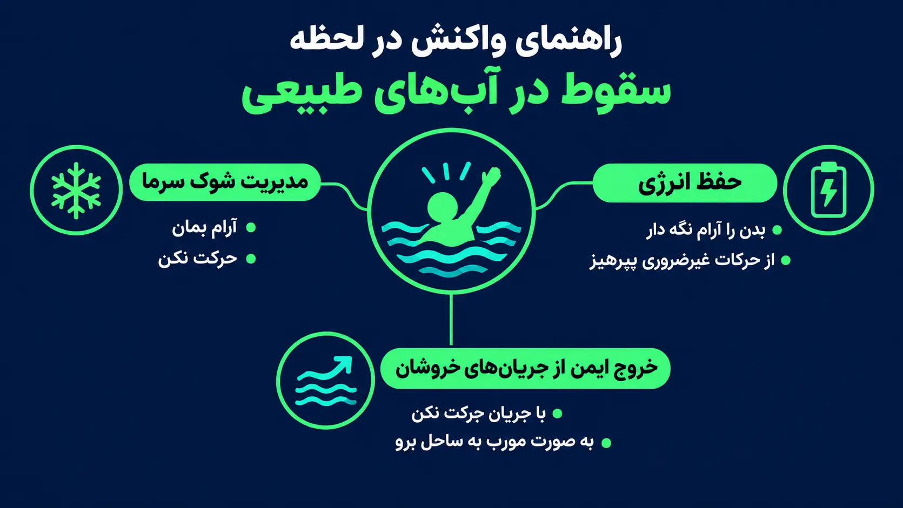

<!-- بلوک سئو — فقط برای ویراستار؛ در صفحه نمایش داده نشود
عنوان سئو: آموزش نجات خویشتن در آب | خودت توی رودخانه افتادی؟
توضیح متا: اگه ناگهان توی آب سرد افتادی چیکار کنی؟ کنترل شوک سرما، شناور ماندن به پشت، قانون ۱-۱۰-۱، خروج از جریان رودخانه و کارهایی که نباید بکنی. ساده و قدم‌به‌قدم.
کلمهٔ کلیدی اصلی: آموزش نجات خویشتن در آب
کلمات کلیدی فرعی: بقا در رودخانه، نجات خود از غرق شدن، شوک سرما در آب، شناور ماندن در آب، وضعیت HELP، جریان برگشتی دریا، سقوط در آب سرد
نامک: self-rescue-drowning
سطح ریسک: بسیار بالا؛ نجات جان، غرق‌شدگی و آب سرد
اسکیما: Article، BreadcrumbList، HowTo، FAQPage
چکیده: راهنمای عملی لحظه‌ای که خودت در آب می‌افتی: چطور شوک سرما را رد کنی، به پشت شناور بمانی، در رودخانه پاها را جلو بگیری و با زاویه به کناره برسی، در دریا از جریان برگشتی بیرون بیایی و بعد از خروج از آب از افت دما جلوگیری کنی.
تصویر شاخص: guides/self-rescue-drowning.webp
متن جایگزین تصویر: اینفوگرافیک آموزش نجات خویشتن در آب: علامت‌دادن برای کمک و وضعیت جمع‌شدن با جلیقهٔ نجات
وضعیت: آمادهٔ انتشار
-->

# آموزش نجات خویشتن در آب: خودت افتادی توی آب سرد؟ اول نفس، بعد شنا.

**نویسنده:** تیم تحریریه آموزش‌های بقا | **آخرین به‌روزرسانی:** ۲۲ مهر ۱۴۰۵ | [روش تهیهٔ مقالات](/editorial-policy)

> **پاسخ سریع:** اگر ناگهان در آب افتادی، در یک دقیقهٔ اول هیچ کاری جز کنترل نفس نکن: به پشت برگرد، دست‌وپا را باز کن و بگذار نفس‌های تند و بی‌اختیار (شوک سرما) آرام شود. بعد تصمیم بگیر: ساحل نزدیک است، آرام و زاویه‌دار به سمتش برو؛ در رودخانه به پشت با پاهای جلو و روی سطح آب به کناره برس؛ در دریا موازی ساحل از جریان برگشتی بیرون بیا؛ کمک در راه است، شناور بمان و انرژی نگه دار. بیرون از آب خشک و گرم شو؛ سرفه یا تنگی نفس یعنی اورژانس ۱۱۵ یا پزشک.

> ### ⚠️ این آموزش شانس بقا را بالا می‌برد، نه اینکه رودخانه را بی‌خطر کند
> در سیلاب، آبشار، سرریز سد و زیر بندهای کوتاه انحرافی هیچ تکنیکی تضمین نمی‌دهد؛ نیروی آب در این نقاط از توان بهترین شناگرها هم بیشتر است. این مقاله برای سقوط ناگهانی در رودخانه، دریاچه و دریا نوشته شده و جایگزین دورهٔ عملی شنا و نجات غریق نیست. بهترین نجات خویشتن، پوشیدن جلیقهٔ نجات و نزدیک‌نشدن به لبهٔ لغزنده است.

## مقدمه

فرض کن از روی سنگ‌های خیس کنار رودخانه رد می‌شوی، پایت لیز می‌خورد و یک‌دفعه تا گردن در آب سرد فرو می‌روی. نفس‌ات بند می‌آید، قلبت تند می‌زند و اولین غریزه این است که با تمام قدرت دست‌وپا بزنی. دقیقاً همین غریزه بیشترین قربانی را می‌گیرد. پایین‌تر می‌بینی بدن در آب سرد چه مراحلی را رد می‌کند، در هر مرحله چه کاری درست است، در رودخانه و دریا چطور به کناره برسی و بعد از بیرون آمدن چه خطری هنوز کمین کرده است.

## پیش‌نیازها و شرایط

- جلیقهٔ نجات را در قایق‌سواری، عبور از رودخانه و کار نزدیک آب خروشان همیشه بپوش.
- شنا بلد بودن در استخر با زنده ماندن در آب سرد و جاری فرق دارد؛ شناور ماندن به پشت را در آب آرام و کم‌عمق، با مراقب، تمرین کن.
- قبل از عبور از رودخانه پایین‌دست را نگاه کن: صخره، درخت افتاده یا سرریز می‌بینی؟ وارد آب نشو.
- هم‌سفرها باید [نجات از ساحل بدون ورود به آب](/drowning-rescue-guide) را بلد باشند؛ نجات خویشتن و نجات از ساحل دو نیمهٔ یک مهارت‌اند.
- شمارهٔ ۱۱۵ (اورژانس) و ۱۱۲ (امداد هلال‌احمر) را بلد باش.

## جدول تصمیم: بر اساس جای سقوط چه کنم

| وضعیت | کار درست | انرژی | هرگز |
|---|---|---|---|
| آب آرام، ساحل نزدیک | یک دقیقه نفس را کنترل کن، بعد آرام و با حرکات بلند به ساحل برو | کم | شنای پرتلاش در دقیقهٔ اول |
| آب آرام، ساحل دور، کمک در راه | به پشت شناور بمان؛ با جلیقه زانوها را بغل بگیر (وضعیت HELP) | حداقل | شنای طولانی به امید رسیدن |
| رودخانهٔ جاری | به پشت، پاها جلو و روی سطح، زاویه‌دار به کناره؛ پشت سنگ‌ها نفس بگیر | متوسط | ایستادن در آب جاری، شنا به بالادست |
| دریا، جریان برگشتی | موازی ساحل شنا کن تا از نوار جریان خارج شوی، بعد مورب به ساحل | متوسط | شنای مستقیم مقابل جریان |
| نزدیک سرریز سد یا درخت افتاده | زودتر و با همهٔ توان خودت را به کناره برسان | هرچه داری | نزدیک‌شدن به دهانهٔ سرریز |

## مراحل نجات خویشتن بعد از سقوط در آب

**مناسب برای:** کسی که ناگهان و بدون آمادگی در آب سرد افتاده (رودخانه، دریاچه، سد، دریا)؛ با یا بدون جلیقهٔ نجات.

**لازم داری:** چیزی لازم نیست؛ فقط ذهن آرام و ترتیب درست کارها. جلیقه، کوله با کیسهٔ ضدآب یا هر چیز شناور داری، نگهش دار.

**زمان:** قانون «۱-۱۰-۱»: حدود ۱ دقیقه تا شوک سرما آرام شود، حدود ۱۰ دقیقه حرکت مؤثر عضلات قبل از بی‌حس شدن دست‌وپا، و حدود ۱ ساعت تا افت خطرناک دمای بدن و از دست رفتن هوشیاری. اعداد تقریبی‌اند و با دمای آب و جثه فرق می‌کنند.

**هشدار:** در آب جاری هیچ‌وقت سعی نکن بایستی؛ گیرکردن پا بین سنگ‌ها در آب تا زانو هم می‌تواند تو را زیر آب نگه دارد. در دریا هرگز مستقیم مقابل جریان برگشتی شنا نکن.

**تصویر:** سه کارت آموزشی در متن: شناور ماندن، عبور از رودخانه و گرم‌شدن بعد از خروج.


۱. **دقیقهٔ اول: فقط نفس**

برخورد ناگهانی با آب سرد چند واکنش بی‌اختیار می‌سازد: یک نفس عمیق ناگهانی، نفس‌های تند و کوتاه، تپش قلب و وحشت. به این حالت «شوک سرما» می‌گویند و خودش بی‌خطر است؛ خطر آنجاست که آن نفس ناگهانی زیر آب کشیده شود یا در همین حالت شنای شدید را شروع کنی.

- سرت را بالا نگه دار و به پشت بچرخ؛ دهانت را از موج و پاشش آب دور کن.
- دست‌ها و پاها را مثل ستاره باز کن؛ ریه‌های پر از هوا تو را روی آب نگه می‌دارند.
- عمداً آهسته بازدم کن و تا سه بشمار. در کمتر از یک دقیقه نفس‌ها آرام می‌شود.
- در این دقیقه تصمیم نگیر و شنا نکن؛ فقط شناور بمان.

:::sa-topic-card
image: topic-cards/self-rescue-drowning-float-star-position.webp
alt: فردی به پشت روی آب خوابیده، دست‌ها و پاها مثل ستاره باز و سر بالا
title: دقیقهٔ اول: فقط نفس و شناور ماندن
description: سر بالا، به پشت بچرخ و دست‌ها و پاها را باز نگه دار؛ ریهٔ پر از هوا تو را نگه می‌دارد. بازدم را آهسته کن و تا سه بشمار و در این دقیقه تصمیم نگیر.
:::

۲. **نگاه کن و تصمیم بگیر**

وقتی نفس آرام شد، سه چیز را پیدا کن: نزدیک‌ترین نقطهٔ خروج (ساحل کم‌شیب، کنارهٔ داخلی پیچ رودخانه)، جهت جریان و خطرهای پایین‌دست (درخت افتاده، صخره، سرریز). بعد یکی از سه مسیر را انتخاب کن: شنا به ساحل نزدیک، شناور ماندن تا رسیدن کمک، یا حرکت زاویه‌دار به سمت کنارهٔ رودخانه. اگر کسی در ساحل هست، با دست بلند و فریاد «کمک» خبرش کن و دوباره انرژی را ذخیره کن.

۳. **شناور ماندن و حفظ گرما**

- **بدون جلیقه:** به پشت بخواب، دست‌ها و پاها را کمی باز کن و فقط با حرکت ملایم مچ دست‌ها تعادل را نگه دار؛ گوش‌ها زیر آب می‌روند، صورت بیرون می‌ماند. پاها را به سینه نکش؛ بدون جلیقه این کار صورت را زیر آب می‌برد.
- **با جلیقهٔ نجات:** زانوها را بغل بگیر و دست‌ها را روی سینه ضربدری کن؛ این وضعیت کاهش اتلاف گرما (HELP) زیر بغل و کشالهٔ ران را می‌پوشاند. چند نفر با جلیقه هستید؟ حلقه بزنید و سینه‌ها را به هم بچسبانید.
- لباس را درنیاور؛ لباس خیس لایهٔ آبی کنار بدن نگه می‌دارد که از آب آزاد گرم‌تر است. فقط چکمهٔ سنگین یا کولهٔ سنگینی که پاها را پایین می‌کشد رها کن.

**جایگزین خلاقانه: چیزی برای شناور ماندن نداری؟** کوله‌ای که وسایلش در کیسهٔ ضدآب بسته است خودش حلقهٔ نجات است؛ آن را جلوی سینه بگیر، نه پشت. شلواری که در دست داری را از پاچه‌ها گره بزن، کمرش را باز نگه دار و با یک حرکت سریع از بالای سر به آب بکوب تا هوا در پاچه‌ها حبس شود؛ گرهٔ خیس چند دقیقه هوا را نگه می‌دارد. بطری یا دبهٔ دربسته را زیر سینه بگیر.

۴. **در رودخانه: پاها جلو، زاویه به کناره**

- به پشت بخواب، سر به سمت بالادست و پاها به سمت پایین‌دست، نوک انگشتان پا بیرون از آب؛ پاها ضربه‌گیر تو در برخورد با سنگ‌ها هستند (وضعیت دفاعی پا جلو).
- با دست‌ها پارو بزن تا بدن با زاویهٔ حدود ۴۵ درجه نسبت به جریان به سمت کنارهٔ انتخابی برود؛ مستقیم مقابل جریان شنا نکن.
- وقتی آب آرام و زیر زانو شد، اول چهار دست و پا بیرون بخز، بعد بایست.
- درخت افتاده یا تودهٔ شاخه (صافی) جلوی مسیر است؟ دور زدنش اولویت است. اگر برخورد اجتناب‌ناپذیر شد، روی شکم بچرخ، با همهٔ توان و سر جلو به سمتش شنا کن و خودت را از رویش بالا بکش؛ آب از لای شاخه‌ها رد می‌شود ولی تو را نگه می‌دارد و زیر آب می‌برد.

:::sa-topic-card
image: topic-cards/self-rescue-drowning-feet-first-in-river.webp
alt: شناور به پشت در رودخانه، سر به بالادست، نوک پا بیرون از آب و بدن با زاویه به سمت کناره
title: پاها جلو، زاویه به کناره
description: به پشت بخواب با پاها به پایین‌دست و نوک انگشتان بیرون از آب؛ با دست‌ها پارو بزن تا بدن با زاویه به کنارهٔ کم‌شیب برود، نه مستقیم مقابل جریان.
:::

۵. **در دریا: با جریان برگشتی نجنگ**

جریان برگشتی (شکافنده) نوار باریکی از آب است که از ساحل به سمت دریا می‌رود؛ تو را زیر آب نمی‌برد، فقط دور می‌کند. اگر با وجود شنا داری از ساحل دور می‌شوی: شناور بمان، موازی ساحل شنا کن تا از نوار جریان بیرون بیایی (معمولاً چند ده متر)، بعد با زاویه به ساحل برگرد. خسته‌ای؟ به پشت شناور بمان و دست تکان بده؛ جریان کمی دورتر ضعیف می‌شود.

۶. **بیرون از آب: خطر هنوز تمام نشده**

- از باد پناه بگیر، لباس خیس را بچلان یا با لباس خشک عوض کن؛ سر و گردن را بپوشان.
- نوشیدنی گرم و شیرین خوب است، البته فقط اگر کاملاً هوشیار باشی و سرفه و استفراغ نداشته باشی.
- لرزش قطع شده، گیجی یا خواب‌آلودی؟ این افت دمای بدن (هیپوترمی) است؛ راهنمای [کمک‌های اولیه سرمازدگی](/hypothermia-first-aid) را اجرا کن و ۱۱۵ را خبر کن.
- آب به ریه‌ات رفته، سرفهٔ مداوم یا تنگی نفس داری؟ حتی اگر حالت خوب است باید پزشک تو را ببیند؛ مشکل تنفسی می‌تواند ساعت‌ها بعد ظاهر شود.

:::sa-topic-card
image: topic-cards/self-rescue-drowning-out-of-water-warm.webp
alt: خارج از آب: لباس خیس چلانده‌شده، کلاه و پتوی نجات روی سر و گردن و یک لیوان نوشیدنی گرم
title: بیرون از آب خطر تمام نشده
description: باد را پشت کن، لباس خیس را بچلان یا با خشک عوض کن و سر و گردن را بپوشان؛ نوشیدنی گرم فقط برای فرد کاملاً هوشیار. لرزشِ قطع‌شده با گیجی یعنی افت دمای بدن.
:::

## بومی‌سازی برای ایران

- رودخانه‌های کرج، هراز، سفیدرود، زاینده‌رود و ارمند در بهار با ذوب برف چند برابر پرآب می‌شوند؛ جایی که در پاییز تا زانو بود، در اردیبهشت آدم را می‌برد.
- بیشتر غرق‌شدگی‌های رودخانه‌ای ایران از کنار پیک‌نیک شروع می‌شود: پای لغزیده روی سنگ خزه‌دار، نه شنای عمدی. کفش با زیرهٔ چسبنده بپوش و روی سنگ خیس پا نگذار.
- بندهای کوتاه انحرافی و سرریزها پایین‌دست خود چرخش دائمی آب می‌سازند که آدم را بارها زیر و رو می‌کند و راه خروج قابل اتکایی ندارد؛ از هر دو طرف فاصلهٔ زیاد بگیر و اگر در آب هستی، پیش از رسیدن به آن با همهٔ توان به کناره برس.
- در سواحل خزر جریان برگشتی شایع است و بیشتر مرگ‌ها در سواحل بدون نجات‌غریق رخ می‌دهد؛ فقط در طرح‌های سالم‌سازی و بین پرچم‌ها شنا کن.

## نکات ایمنی

۱. هشدار: در دقیقهٔ اول دست‌وپا نزن؛ به‌جایش: به پشت برگرد و نفس را کنترل کن.

۲. هشدار: در آب جاری نایست؛ به‌جایش: به پشت، پاها جلو و روی سطح آب، تا رسیدن به آب آرام زیر زانو.

۳. هشدار: مقابل جریان رودخانه یا جریان برگشتی دریا شنا نکن؛ به‌جایش: زاویه‌دار به کناره یا موازی ساحل.

۴. هشدار: لباس را برای «سبک‌تر شدن» درنیاور؛ به‌جایش: فقط کوله یا چکمهٔ سنگینی که تو را پایین می‌کشد رها کن.

۵. هشدار: بدون جلیقه زانوها را به سینه نکش؛ به‌جایش: ستاره‌ای به پشت بخواب.

۶. هشدار: بیرون از آب خودت را «خوب» فرض نکن؛ به‌جایش: خشک و گرم شو و با سرفه یا تنگی نفس به پزشک یا ۱۱۵ زنگ بزن.

۷. هشدار: برای کمک به کسی که افتاده، پشت سرش نپر توی آب؛ به‌جایش: از ساحل وسیله برسان یا پرت کن.

## باورهای غلط

**باور غلط:** «توی آب سرد باید سریع و محکم شنا کنی تا گرم بمونی.»

**واقعیت:** شنای شدید همزمان با شوک سرما نفس را از کنترل خارج می‌کند و آب را به ریه می‌فرستد؛ بعد هم خون گرم را به دست‌وپا می‌برد و بدن سریع‌تر سرد می‌شود. اول آرام شو، بعد فقط به اندازهٔ رسیدن به ساحل شنا کن.

**باور غلط:** «اگه شنا بلد نباشی، در هر صورت فرو می‌ری.»

**واقعیت:** بدن با ریه‌های پر از هوا شناور می‌ماند، به شرطی که به پشت باشی و دست‌وپا نزنی. بسیاری از غرق‌شده‌ها شناگر بودند که با جریان جنگیدند.

**باور غلط:** «گرفتگی عضله باعث غرق شدن می‌شه.»

**واقعیت:** گرفتگی به‌تنهایی کسی را غرق نمی‌کند؛ وحشت بعد از آن غرق می‌کند. پایت گرفت؟ به پشت بچرخ، شناور بمان، پنجه را به سمت ساق بکش و عضله را با دست باز کن.

**باور غلط:** «رودخانهٔ کم‌عمق خطر نداره، چون می‌تونی بایستی.»

**واقعیت:** آب جاری تا زانو هم پا را از زمین می‌کند و اگر پا لای سنگ‌ها گیر کند، جریان بالاتنه را زیر آب فشار می‌دهد. در آب جاری نایست.

## عیب‌یابی و علائم خطر

- **نفس‌ها بعد از یک دقیقه آرام نمی‌شود:** صورت را از موج دور کن و بازدم را عمداً بلند و شمرده کن؛ تمرکز روی شمارش وحشت را کم می‌کند.
- **دست‌ها بی‌حس شده و پارو نمی‌زنند:** زمان حرکت مؤثر رو به پایان است؛ ساحل نزدیک است، همین حالا با پاها هل بده؛ نیست، شناور بمان و انرژی را برای نگه داشتن سر و فریاد خرج کن.
- **لرزش بیرون از آب قطع شد و خواب‌آلودی:** افت دمای بدن در حال پیشرفت است؛ رانندگی نکن، از هم‌سفرها بخواه گرم‌ات کنند و ۱۱۵ را خبر کنند.
- **سرفهٔ مداوم، تنگی نفس، خس‌خس یا لب کبود در ساعات بعد:** نشانهٔ ورود آب به ریه؛ فوری اورژانس یا بیمارستان.

## پیشگیری و کیت

- جلیقهٔ نجات اندازهٔ هر نفر برای قایق، رفتینگ و عبور از رودخانه؛ برای بچه‌ها حتی در آب کم‌عمق.
- طناب ۱۰ تا ۱۵ متری و یک چیز شناور (دبه، کیسهٔ پرتاب) در وسایل سفر کنار آب؛ کوله با کیسهٔ ضدآب که خودش شناور می‌ماند.
- کفش با زیرهٔ چسبنده و عصا برای عبور از رودخانه؛ رو به بالادست، با گام‌های کوتاه و کمربند کوله باز.
- یک دست لباس خشک در کیسهٔ ضدآب و پتوی نجات برای بعد از خروج از آب.

## پرسش‌های رایج

**۱. شنا بلد نیستم و افتادم توی آب. اصلاً شانسی دارم؟**
بله. در دقیقهٔ اول فقط به پشت بچرخ، دست‌وپا را باز کن و نفس را آرام کن؛ بدن با ریهٔ پر از هوا شناور می‌ماند. بعد با حرکت کوچک و آرام به سمت نزدیک‌ترین کناره برو و با فریاد و دست بلند کمک بخواه. دست‌وپا زدن شدید تنها چیزی است که این شانس را از بین می‌برد.

**۲. چقدر می‌شود در آب سرد زنده ماند؟**
بستگی به دمای آب، جثه و لباس دارد. قانون تقریبی ۱-۱۰-۱ می‌گوید حدود یک دقیقه برای کنترل نفس، حدود ده دقیقه حرکت مؤثر و حدود یک ساعت تا بیهوشی ناشی از افت دما داری؛ یعنی وقت داری فکر کنی، به شرطی که دقیقهٔ اول را با وحشت هدر ندهی.

**۳. در رودخانه جریان مرا می‌برد؛ بایستم یا شنا کنم؟**
هیچ‌کدام؛ به پشت بخواب، پاها را جلو و روی سطح آب بگیر و با دست‌ها پارو بزن تا با زاویه به سمت کناره بروی. پشت سنگ‌های بزرگ نفس بگیر و فقط وقتی آب آرام و زیر زانو شد، چهار دست و پا بیرون بخز.

**۴. در دریا هرچه شنا می‌کنم دورتر می‌شوم. چه کار کنم؟**
گرفتار جریان برگشتی شده‌ای. با آن نجنگ؛ موازی ساحل شنا کن تا از نوار جریان بیرون بیایی و بعد با زاویه به ساحل برگرد. خسته‌ای؟ به پشت شناور بمان و دست تکان بده تا نجات‌غریق برسد.

**۵. از آب بیرون آمدم و حالم خوب است. باز هم باید پزشک بروم؟**
اگر آب به ریه‌ات رفته یا بعد از خروج سرفه، تنگی نفس، خس‌خس، خواب‌آلودگی یا گیجی داری، بله؛ مشکلات تنفسی بعد از نیمه‌غرق‌شدگی می‌تواند ساعت‌ها بعد شروع شود. بدون هیچ علامتی، خودت را گرم کن و تا چند ساعت زیر نظر هم‌سفرها باش.

## چک‌لیست جمع‌بندی

- [ ] دقیقهٔ اول: به پشت، دست‌وپا باز، فقط کنترل نفس؛ شنا نکن.
- [ ] نگاه کن: نزدیک‌ترین خروجی، جهت جریان، خطر پایین‌دست.
- [ ] شناور بمان: بدون جلیقه ستاره‌ای به پشت؛ با جلیقه زانو بغل (HELP).
- [ ] رودخانه: پاها جلو و روی سطح، زاویه‌دار به کناره؛ تا آب آرام و زیر زانو نشده نایست.
- [ ] دریا: موازی ساحل از جریان برگشتی بیرون بیا.
- [ ] بیرون از آب: خشک، گرم، زیر نظر؛ سرفه یا تنگی نفس یعنی ۱۱۵ یا پزشک.

## لینک‌های مرتبط

- [نجات فردی که در آب افتاده](/drowning-rescue-guide) — وقتی دیگری در آب است و تو در ساحل
- [لباس مناسب برای طبیعت در هر فصل](/outdoor-clothing-guide) — لایه‌بندی که بعد از خیس شدن نجاتت می‌دهد
- [معرفی طناب و کارابین](/rope-carabiner-guide)
- [کیف کمک‌های اولیه](/first-aid-kit-checklist)
- [هاب آموزش‌های کمپینگ](/category/camping-survival/)

## منابع

- سازمان جهانی بهداشت (WHO) — گزارش جهانی غرق‌شدگی و اصول پیشگیری.
- مؤسسهٔ ملی نجات جان بریتانیا (RNLI) — کارزار «شناور بمان» و واکنش به شوک سرما.
- صلیب سرخ آمریکا (American Red Cross) — ایمنی در آب‌های طبیعی، جریان برگشتی و وضعیت HELP.
- انجمن پزشکی کوهستان (WMS) — راهنمای بالینی غوطه‌وری در آب سرد و افت دمای بدن.
- فدراسیون نجات غریق و غواصی و هلال‌احمر جمهوری اسلامی ایران — دوره‌های حضوری ایمنی در آب.
- پیوند منابع پس از تأیید URL اضافه می‌شود؛ تا آن زمان نام سازمان و موضوع راهنما درج شده است.

## پیام پایانی

تمام این مقاله در یک جمله: اول نفس، بعد فکر، بعد حرکت. آب سرد در دقیقهٔ اول همهٔ تلاشش را می‌کند که تو را به وحشت بیندازد و همان وحشت است که غرق می‌کند، نه آب. یک بار در آب آرام تمرین کن که به پشت بخوابی و آرام بازدم کنی تا بدنت در روز بد همان کار را بکند. جلیقه را بپوش، روی سنگ خیس پا نگذار و قبل از هر رودخانه پایین‌دست را نگاه کن؛ بیشتر نجات‌های خویشتن قبل از افتادن در آب انجام می‌شوند.

---


*این مقاله جنبهٔ آموزشی دارد و جایگزین توصیهٔ پزشکی، راهنمای محلی، آموزش عملی یا دستور سازندهٔ محصولات نیست.*

## اسکیما برای پیاده‌سازی

```json
{
  "@context": "https://schema.org",
  "@graph": [
    {
      "@type": "Article",
      "headline": "آموزش نجات خویشتن در آب: خودت افتادی توی آب سرد؟ اول نفس، بعد شنا.",
      "description": "اگه ناگهان توی آب سرد افتادی چیکار کنی؟ کنترل شوک سرما، شناور ماندن به پشت، قانون ۱-۱۰-۱، خروج از جریان رودخانه و کارهایی که نباید بکنی. ساده و قدم‌به‌قدم.",
      "inLanguage": "fa",
      "url": "https://sarzaminaryan.ir/self-rescue-drowning/",
      "mainEntityOfPage": "https://sarzaminaryan.ir/self-rescue-drowning/",
      "author": {
        "@type": "Organization",
        "name": "تیم تحریریه آموزش‌های بقا"
      },
      "publisher": {
        "@type": "Organization",
        "name": "تیم تحریریه آموزش‌های بقا"
      },
      "dateModified": "2026-10-12"
    },
    {
      "@type": "BreadcrumbList",
      "itemListElement": [
        {
          "@type": "ListItem",
          "position": 1,
          "name": "خانه",
          "item": "https://sarzaminaryan.ir/"
        },
        {
          "@type": "ListItem",
          "position": 2,
          "name": "آموزش نجات خویشتن در آب",
          "item": "https://sarzaminaryan.ir/self-rescue-drowning/"
        }
      ]
    },
    {
      "@type": "HowTo",
      "name": "مراحل نجات خویشتن بعد از سقوط در آب",
      "description": "راهنمای عملی لحظه‌ای که خودت در آب می‌افتی: چطور شوک سرما را رد کنی، به پشت شناور بمانی، در رودخانه پاها را جلو بگیری و با زاویه به کناره برسی، در دریا از جریان برگشتی بیرون بیایی و بعد از خروج از آب از افت دما جلوگیری کنی.",
      "step": [
        {
          "@type": "HowToStep",
          "name": "دقیقهٔ اول: فقط نفس",
          "text": "دقیقهٔ اول: فقط نفس"
        },
        {
          "@type": "HowToStep",
          "name": "نگاه کن و تصمیم بگیر",
          "text": "نگاه کن و تصمیم بگیر"
        },
        {
          "@type": "HowToStep",
          "name": "شناور ماندن و حفظ گرما",
          "text": "شناور ماندن و حفظ گرما"
        },
        {
          "@type": "HowToStep",
          "name": "در رودخانه: پاها جلو، زاویه به کناره",
          "text": "در رودخانه: پاها جلو، زاویه به کناره"
        },
        {
          "@type": "HowToStep",
          "name": "در دریا: با جریان برگشتی نجنگ",
          "text": "در دریا: با جریان برگشتی نجنگ"
        },
        {
          "@type": "HowToStep",
          "name": "بیرون از آب: خطر هنوز تمام نشده",
          "text": "بیرون از آب: خطر هنوز تمام نشده"
        }
      ]
    },
    {
      "@type": "FAQPage",
      "mainEntity": [
        {
          "@type": "Question",
          "name": "شنا بلد نیستم و افتادم توی آب. اصلاً شانسی دارم؟",
          "acceptedAnswer": {
            "@type": "Answer",
            "text": "بله. در دقیقهٔ اول فقط به پشت بچرخ، دست‌وپا را باز کن و نفس را آرام کن؛ بدن با ریهٔ پر از هوا شناور می‌ماند. بعد با حرکت کوچک و آرام به سمت نزدیک‌ترین کناره برو و با فریاد و دست بلند کمک بخواه. دست‌وپا زدن شدید تنها چیزی است که این شانس را از بین می‌برد."
          }
        },
        {
          "@type": "Question",
          "name": "چقدر می‌شود در آب سرد زنده ماند؟",
          "acceptedAnswer": {
            "@type": "Answer",
            "text": "بستگی به دمای آب، جثه و لباس دارد. قانون تقریبی ۱-۱۰-۱ می‌گوید حدود یک دقیقه برای کنترل نفس، حدود ده دقیقه حرکت مؤثر و حدود یک ساعت تا بیهوشی ناشی از افت دما داری؛ یعنی وقت داری فکر کنی، به شرطی که دقیقهٔ اول را با وحشت هدر ندهی."
          }
        },
        {
          "@type": "Question",
          "name": "در رودخانه جریان مرا می‌برد؛ بایستم یا شنا کنم؟",
          "acceptedAnswer": {
            "@type": "Answer",
            "text": "هیچ‌کدام؛ به پشت بخواب، پاها را جلو و روی سطح آب بگیر و با دست‌ها پارو بزن تا با زاویه به سمت کناره بروی. پشت سنگ‌های بزرگ نفس بگیر و فقط وقتی آب آرام و زیر زانو شد، چهار دست و پا بیرون بخز."
          }
        },
        {
          "@type": "Question",
          "name": "در دریا هرچه شنا می‌کنم دورتر می‌شوم. چه کار کنم؟",
          "acceptedAnswer": {
            "@type": "Answer",
            "text": "گرفتار جریان برگشتی شده‌ای. با آن نجنگ؛ موازی ساحل شنا کن تا از نوار جریان بیرون بیایی و بعد با زاویه به ساحل برگرد. خسته‌ای؟ به پشت شناور بمان و دست تکان بده تا نجات‌غریق برسد."
          }
        },
        {
          "@type": "Question",
          "name": "از آب بیرون آمدم و حالم خوب است. باز هم باید پزشک بروم؟",
          "acceptedAnswer": {
            "@type": "Answer",
            "text": "اگر آب به ریه‌ات رفته یا بعد از خروج سرفه، تنگی نفس، خس‌خس، خواب‌آلودگی یا گیجی داری، بله؛ مشکلات تنفسی بعد از نیمه‌غرق‌شدگی می‌تواند ساعت‌ها بعد شروع شود. بدون هیچ علامتی، خودت را گرم کن و تا چند ساعت زیر نظر هم‌سفرها باش."
          }
        }
      ]
    }
  ]
}
```
