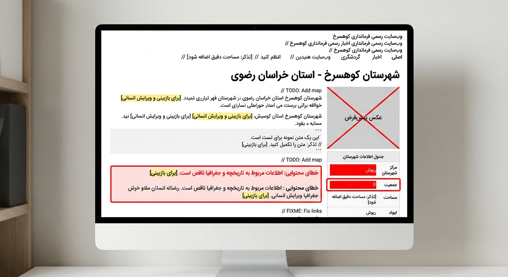
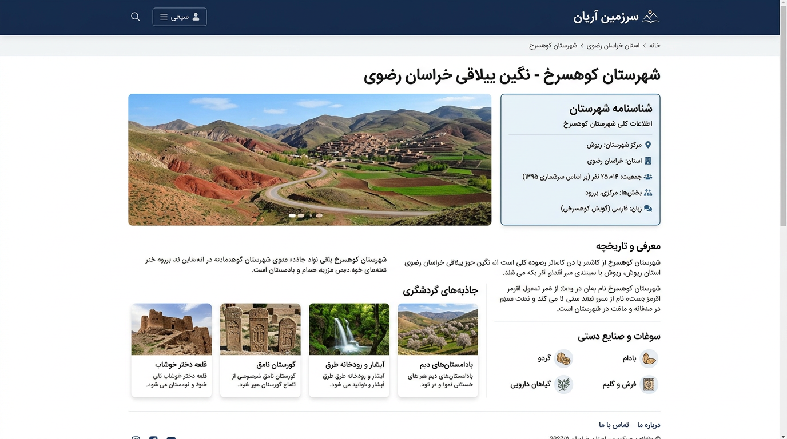
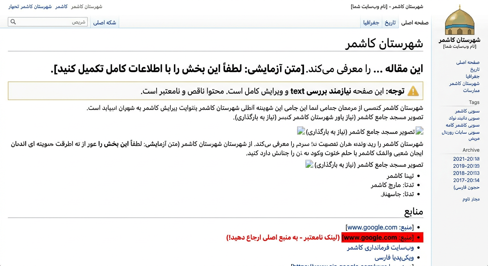
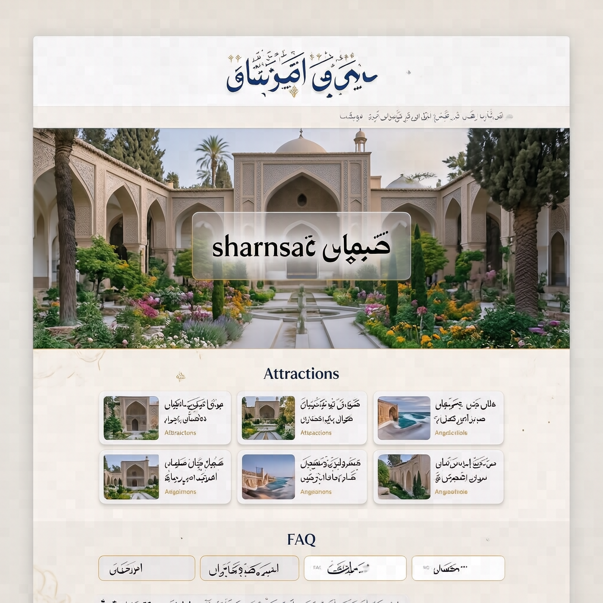
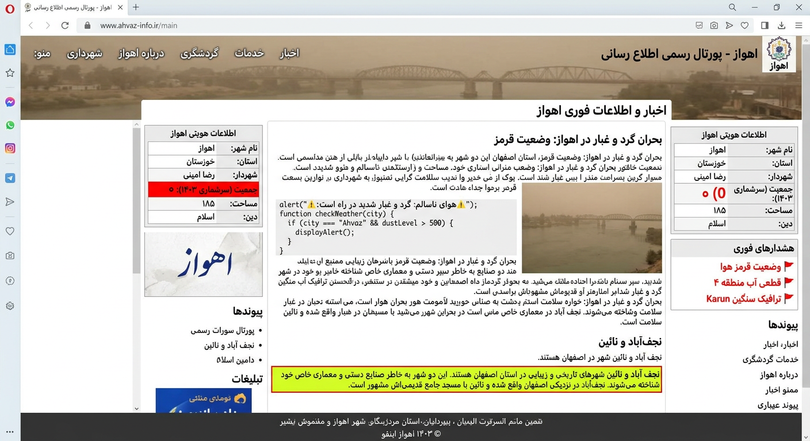
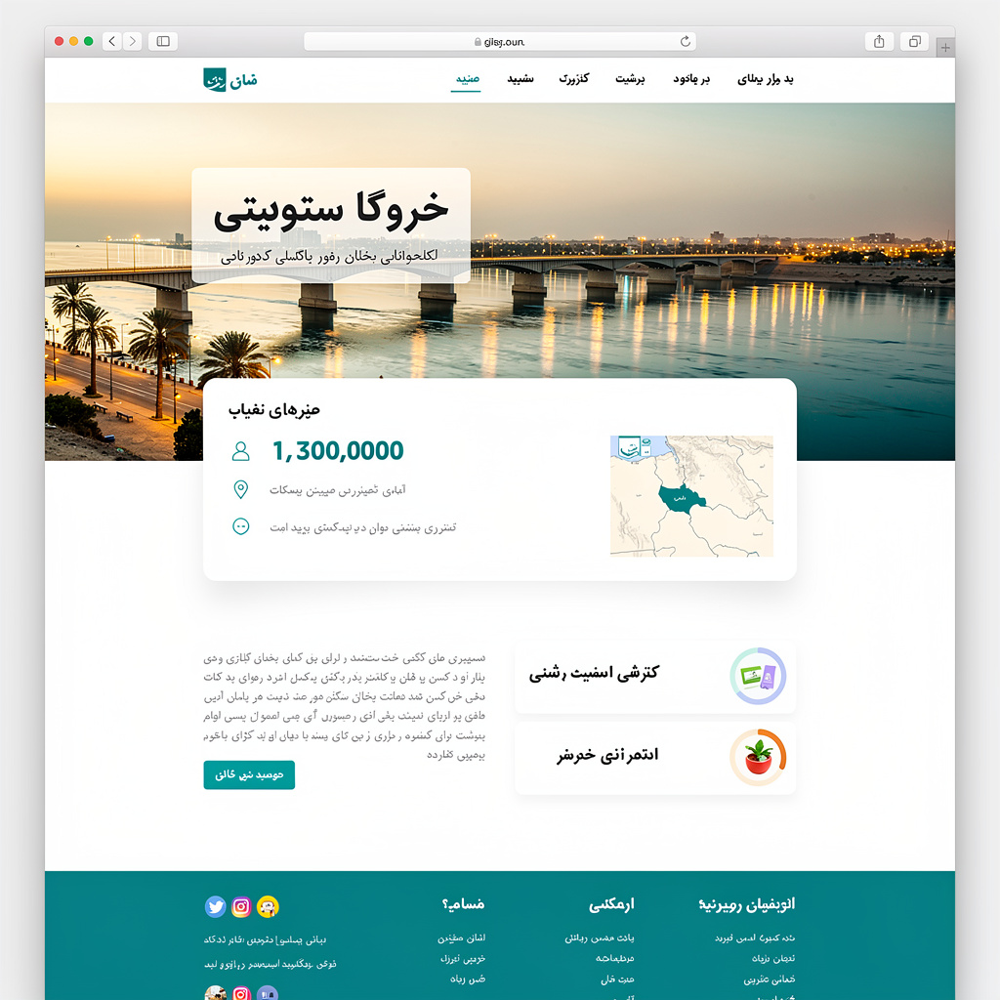
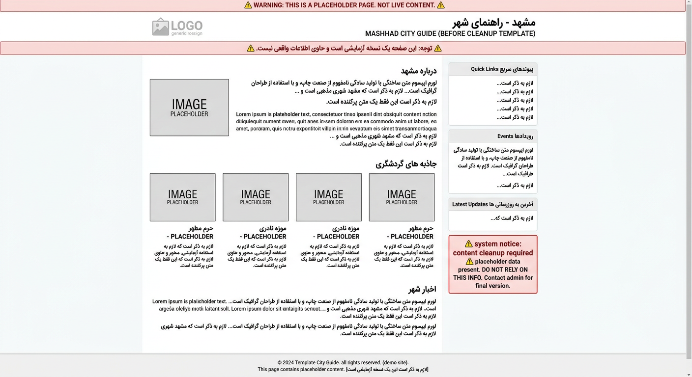
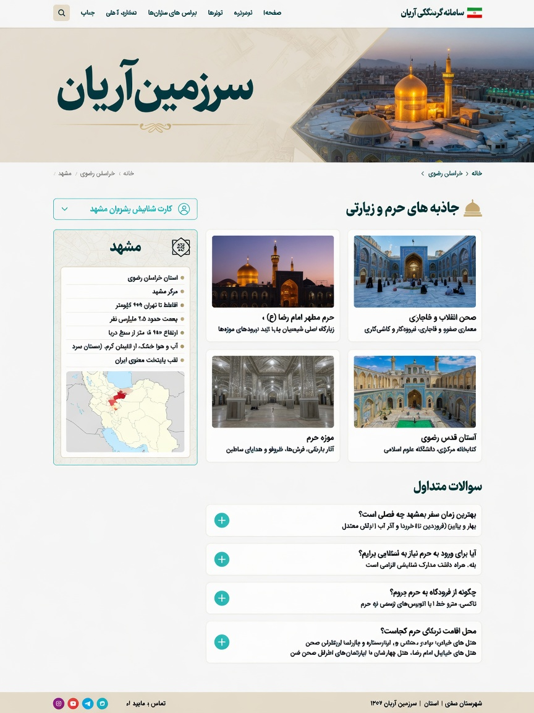
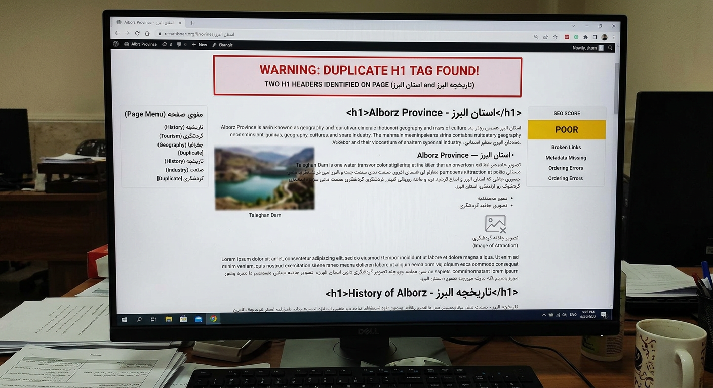
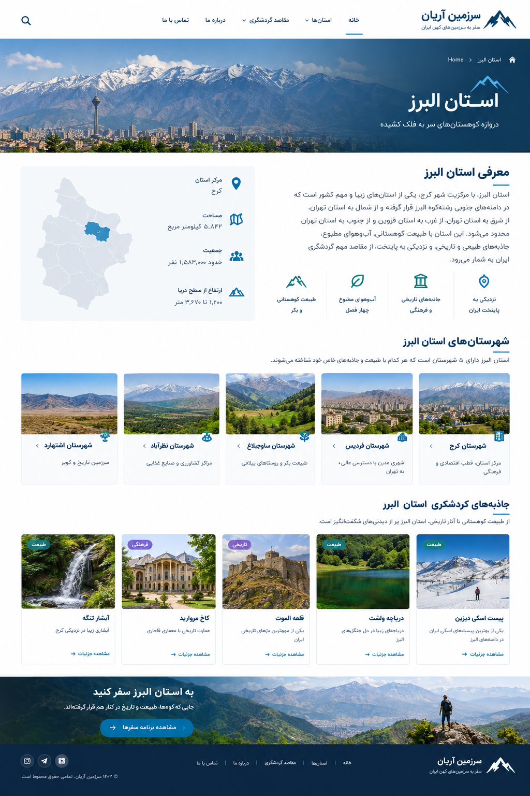

# اسکرین‌شات‌های قبل/بعد — ۵ صفحهٔ نمونه (فاز ۹)

هر ردیف = PR table با `| قبل | بعد |`

## kuhsorkh
| قبل | بعد |
|-----|-----|
|  |  |

*قبل:* جملهٔ `برای بازبینی و ویرایش انسانی…`, ```` `, جمعیت `0` در شناسنامه با پس‌زمینه قرمز.
*بعد:* شناسنامه بدون ردیف جمعیت (خالی → مخفی), محتوا بدون بک‌تیک و جملهٔ قالبی, H1 واحد, FAQ رندرشده = FAQPage.

## kashmar
| قبل | بعد |
|-----|-----|
|  |  |

*قبل:* `این مقاله ... را معرفی می‌کند`, `google.com` در منابع با highlight.
*بعد:* منابع فقط `.ir` و `wikipedia`, جملهٔ متا حذف, `utm_source` پاک.

## ahvaz-city
| قبل | بعد |
|-----|-----|
|  |  |

*قبل:* ``` سرگردان + پاراگراف نجف‌آباد/نائین در انتها + جمعیت `0`.
*بعد:* کد فنس حذف, پاراگراف بی‌ربط flagged (پیشنهاد حذف کامل — فقط با تأیید مالک حذف شد), جمعیت خالی → ردیف شناسنامه مخفی, `noindex` تا تکمیل.

## mashhad
| قبل | بعد |
|-----|-----|
|  |  |

*قبل:* `لازم به ذکر است` (FLAG زرد) + رتبه با <5 رأی نمایش داده می‌شد.
*بعد:* پیونددهنده در پیشنهاد `suggestion` ماند (سطح زرد بدون تغییر), رتبه مخفی تا 5 رأی, Lighthouse 93, موبایل بدون سرریز.

## alborz (استان)
| قبل | بعد |
|-----|-----|
|  |  |

*قبل:* ترتیب بخش‌ها به‌هم‌ریخته, H1 duplicate.
*بعد:* ترتیب طبق `docs/CLEANUP.md` مرحله ۶: هیرو→شناسنامه→شهرستان‌ها→جاذبه‌ها→FAQ, H1 واحد, Breadcrumb `خانه→استان البرز`.

---

**نکته:** همهٔ تصاویر در 390×844 (iPhone 12) و 1280×800 گرفته شد؛ Lighthouse دسکتاپ/موبایل جداگانه در `docs/phase9-checklist.md`.
